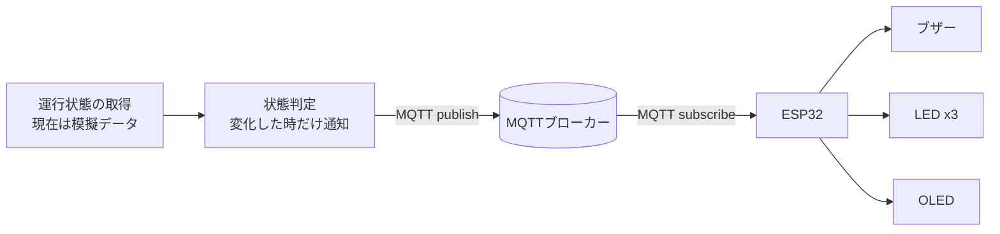

# 運行情報ブザー (Train Status Buzzer)

電車の運行状態をPCで判定し、MQTTでマイコン(ESP32)へ送って、ブザー・LED・OLEDで知らせる組み込みポートフォリオです。

> **現在の状態**
> - マイコン側は **Wokwi(ブラウザ上のシミュレータ)** で動作確認しています。実機での検証はこれからです。
> - 運行状態のデータは **模擬データ(`status.txt`)** です。実際の運行情報への接続はこれからです。

## デモ

<!-- 動作動画のリンクまたはGIFを貼る -->
- !動作動画:(images/demo.gif)
- Wokwiプロジェクト: [Wokwiで試す](https://wokwi.com/projects/477373780953701377)

## 何ができるか

PCから `NORMAL` / `DELAY` / `SUSPENDED` のいずれかを送ると、マイコンが次のように動きます。

| 状態 | 意味 | LED | OLED表示 | ブザー |
|---|---|---|---|---|
| `NORMAL` | 平常 | 緑 | `NORMAL` | 高い音を短く1回 |
| `DELAY` | 遅延 | 黄 | `DELAY` | 中くらいの音を1回 |
| `SUSPENDED` | 運転見合わせ | 赤 | `SUSPENDED` | 低い音を長く3回 |

LEDとOLEDは、次の状態が届くまで現在の状態を表示し続けます。

## 構成



- **PC側 (Python)**: 運行状態を取得し、前回から変わった時だけMQTTで送信します。
- **マイコン側 (C++ / Arduino)**: MQTTで状態を受信し、LED・OLED・ブザーを制御します。

### マイコンに取得処理を持たせない理由
HTMLの解析やHTTPS通信はメモリを多く使うため、データ取得はPC側に任せています。マイコンは「受け取った状態を表示・発音する」役割に絞りました。

## 部品とピン割り当て

| 部品 | ESP32のピン | 備考 |
|---|---|---|
| ブザー | GPIO18 | 端子1 → GPIO18 / 端子2 → GND |
| 緑LED | GPIO19 | 抵抗220Ωを直列に接続 |
| 黄LED | GPIO17 | 抵抗220Ωを直列に接続 |
| 赤LED | GPIO16 | 抵抗220Ωを直列に接続 |
| OLED (SSD1306, I2C) | SDA: GPIO21 / SCL: GPIO22 | VCC → 3V3、GND → GND、アドレス 0x3C |

## 通信仕様 (MQTT)

- ブローカー: `broker.hivemq.com`(公開ブローカー、ポート1883)
- トピック: 他の利用者と重ならない名前に変更して使います(例: `your-unique-topic/status`)
- メッセージ: 文字列 `NORMAL` / `DELAY` / `SUSPENDED`(大文字小文字は区別しません)
- 未知のメッセージは無視します

## 動かし方

### 1. マイコン側 (Wokwi)
1. [Wokwi](https://wokwi.com/) で ESP32 のプロジェクトを新規作成します。
2. 部品(ブザー、LED x3、抵抗 x3、SSD1306 OLED)を追加し、上の表のとおりに配線します。
3. `libraries.txt` に次を追加します。
   ```
   PubSubClient
   Adafruit SSD1306
   Adafruit GFX Library
   ```
4. `firmware/sketch.ino` の内容を `sketch.ino` に貼り付け、`MQTT_TOPIC` を自分用の名前に変えて実行します。

### 2. PC側 (Python)
```
pip install paho-mqtt
```
`pc/train_monitor.py` の `TOPIC` をスケッチと同じ名前にして、次のように実行します。

```
python train_monitor.py
```

同じフォルダの `status.txt` に `NORMAL` / `DELAY` / `SUSPENDED` のいずれかを書いて保存すると、状態が変わった時だけ送信されます。

1回だけ手動で送って試す場合は、次のようにも書けます。

```python
import paho.mqtt.publish as publish
publish.single("your-unique-topic/status", "DELAY", hostname="broker.hivemq.com")
```

## 設計上の判断

- **変化した時だけ通知する**: 遅延が続く間ずっと鳴り続けないよう、PC側が前回の状態を覚えて、変化時だけ送信します。
- **MQTTのコールバックの中では鳴らさない**: コールバック内で待機すると通信処理が止まるため、受信した状態は一度変数にためて、`loop()` で処理します。
- **シリアル入力でも動作確認できる**: `n` / `d` / `s` を入力すると、通信なしでも動作を確認できます。
- **ESP32 Arduinoコアの版差を吸収**: ブザー制御は `ESP_ARDUINO_VERSION_MAJOR` で分岐しています。

## 今の課題と今後の予定

- [ ] 実際の運行情報への接続(公式データの利用条件を確認したうえで実装)
- [ ] `delay()` を使わない `millis()` ベースの動作に変更(音の再生中も通信を取りこぼさないようにする)
- [ ] ボタンで音を止める(割り込みとチャタリング対策)
- [ ] 音の制御と通信をFreeRTOSのタスクに分ける
- [ ] Wi-Fi切断やデータ取得失敗時の動作を整理する(ウォッチドッグ等)
- [ ] ESP32の実機での動作確認
- [ ] 公開ブローカーではなく、認証付きのブローカーを使う

## 注意事項

- 公開MQTTブローカーは誰でも読み書きできます。個人情報や機密情報は送らないでください。
- 運行情報などの外部データを使う場合は、提供元の利用規約とライセンスに従ってください。

## 使用技術

ESP32 (Arduino / C++), PubSubClient, Adafruit SSD1306 / GFX, Python 3, paho-mqtt, MQTT, Wokwi
